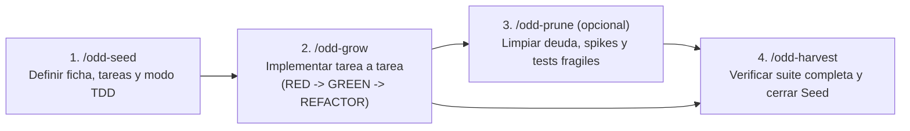

# Guía Rápida de Trabajo: ODD + Conditional TDD en AgenticF

> Resumen operativo del protocolo definido en el Vault de Obsidian **`C:\Users\teylo\obsidian-vaults\expenses-ai-odd-vault`** ([ODD_Master_Protocol.md](file:///C:/Users/teylo/obsidian-vaults/expenses-ai-odd-vault/01_Rules/ODD_Master_Protocol.md) y [Conditional_TDD_Policy.md](file:///C:/Users/teylo/obsidian-vaults/expenses-ai-odd-vault/01_Rules/Conditional_TDD_Policy.md)).

---

## 1. Los 4 Ciclos de ODD

### 1. `/odd-seed` — Sembrar el Seed
- **Cuándo:** Al iniciar cualquier tarea de tamaño **M o L** (cada uno de los 16 Seeds de [ROADMAP_V1.md](./ROADMAP_V1.md)).
- **Qué se hace:**
  - Se inspecciona el código existente, [DECISIONS.md](./DECISIONS.md), [BACKLOG_V2.md](./BACKLOG_V2.md) y `C:\Users\teylo\obsidian-vaults\expenses-ai-odd-vault\06_Architecture\System_Overview.md`.
  - Se crea la ficha del Seed en `C:\Users\teylo\obsidian-vaults\expenses-ai-odd-vault\04_Seeds\YYYY-MM-DD_<nombre-seed>.md` con objetivo, archivos afectados, criterios de aceptación, tareas atómicas (`T1`, `T2`…) y la clasificación **Strict TDD** vs **`[TDD-SKIP]`**.
  - Si hay ambigüedad o riesgos técnicos, se resuelven con el usuario antes de escribir código.

### 2. `/odd-grow` — Crecer tarea por tarea
- **Qué se hace:** Se ejecuta una sola tarea a la vez siguiendo **Conditional TDD**:
  - **Strict TDD (`RED → GREEN → REFACTOR`)** — obligatorio por defecto en lógica de dominio (`packages/domain`), cálculos financieros (`decimal.js`, multimoneda, timezones), validaciones, `CommandBus`, `Undo`, seguridad, guardrails del agente, endpoints API y corrección de bugs:
    1. **RED:** Escribir el test que valida la regla (o reproduce el bug) y ejecutarlo para comprobar que falla por el motivo esperado.
    2. **GREEN:** Implementar el código mínimo para que pase.
    3. **REFACTOR:** Limpiar duplicación y nombres manteniendo todos los tests en verde.
  - **Excepción `[TDD-SKIP]`** — solo para Dockerfiles, config CI/tooling, variables de entorno, estilos visuales puros sin lógica o spikes desechables en `05_Spikes/`:
    - Debe declararse explícitamente: `[TDD-SKIP] Reason: <motivo técnico>. Alternative verification: <lint/build/smoke-test>.`
  - **Regla de bloqueo:** No se pasa a la siguiente tarea si hay tests rotos o errores de tipos.

### 3. `/odd-prune` — Podar (cuando aplica / al cerrar un Bloque)
- **Qué se hace:**
  - Revisar código recién modificado y tests asociados.
  - Eliminar código muerto, duplicación y experimentos en `C:\Users\teylo\obsidian-vaults\expenses-ai-odd-vault\05_Spikes/` ya integrados o descartados.
  - **Poda de tests:** Consolidar tests frágiles o acoplados a detalles internos en tests de comportamiento claros.
  - Ejecutar la suite completa y linters para confirmar cero regresiones.

### 4. `/odd-harvest` — Cosechar y cerrar el Seed
- **Qué se hace:**
  1. Verificar que todas las tareas del Seed están completadas `[x]` con evidencia real.
  2. Ejecutar la verificación completa del monorepo (`typecheck`, `lint`, `test`, `build`).
  3. Pegar la evidencia real en la sección `## 📊 Closing Evidence` del Seed y actualizar el frontmatter a `status: harvested`.
  4. Actualizar la memoria viva:
     - `C:\Users\teylo\obsidian-vaults\expenses-ai-odd-vault\06_Architecture\System_Overview.md` (nuevos contratos, patrones o ADRs).
     - [ROADMAP_V1.md](./ROADMAP_V1.md) (marcar el Seed como `✅ Harvested`).

> **Tareas pequeñas (Tamaño S):** Micro-arreglos o retoques locales se ejecutan directamente sin crear un Seed nuevo en `04_Seeds/`, manteniendo TDD obligatorio si se trata de un bug fix (primero test que reproduce el bug).

---

## 2. Protocolo ante Cambios en Decisiones ([DECISIONS.md](./DECISIONS.md))

1. **Aviso previo obligatorio:** Si una petición contradice una decisión cerrada en [DECISIONS.md](./DECISIONS.md) o adelanta un elemento de [BACKLOG_V2.md](./BACKLOG_V2.md), el agente debe **avisar antes de implementar** indicando el conflicto y su impacto.
2. **Actualización sincronizada (si el usuario aprueba el cambio):**
   - Actualizar [DECISIONS.md](./DECISIONS.md) documentando la nueva decisión.
   - Registrar o actualizar el ADR correspondiente en `C:\Users\teylo\obsidian-vaults\expenses-ai-odd-vault\06_Architecture\System_Overview.md`.
   - Ajustar [ROADMAP_V1.md](./ROADMAP_V1.md) y/o [BACKLOG_V2.md](./BACKLOG_V2.md) si cambia el alcance.

---

## 3. Niveles de Verificación y Tests

| Nivel | Cuándo se ejecuta | Comandos / Checks |
| :--- | :--- | :--- |
| **1. Por tarea (`/odd-grow`)** | En cada tarea TDD (`RED` y `GREEN`/`REFACTOR`) | Tests focalizados del paquete/módulo afectado |
| **2. Al cerrar cada Seed (`/odd-harvest`)** | Antes de marcar un Seed como `harvested` | Suite completa: `pnpm typecheck`, `pnpm lint`, `pnpm test`, `pnpm build` (+ smoke test / Docker / UI si aplica) |
| **3. Al cerrar cada Bloque** | Al completar todos los Seeds de un Bloque | Revisión integrada de punta a punta + `/odd-prune` si hay deuda o ajustes |
| **4. Pre-push y CI (desde Seed 02)** | Automático antes de cada `git push` y en GitHub Actions | **Lefthook** local (`typecheck`, `lint`, `test`, `Gitleaks`) + **GitHub Actions** (`pnpm audit`, `Gitleaks`, `Semgrep OSS`, build) |

---

## 4. Estrategia Git: Rama por Bloque y Commit por Seed

- **1 Rama por Bloque** (creada desde `main`):
  - `block/01-foundations` (Seeds 01–03)
  - `block/02-domain-money-time-fx` (Seeds 04–06)
  - `block/03-identity-commandbus` (Seeds 07–08)
  - `block/04-core-finance-offline` (Seeds 09–12)
  - `block/05-analytics-investments-networth` (Seeds 13–14)
  - `block/06-agent-nas-deploy` (Seeds 15–16)
- **1 Commit atómico por Seed** al cerrar `/odd-harvest` con formato Conventional Commits:
  - Ejemplo: `feat(seed-04): add decimal.js money engine and multicurrency formatting`
  - Pequeños fixes entre Seeds (tamaño S) pueden ir en su propio commit `fix(<scope>): ...` dentro de la rama activa.
- **Pull Request a `main` al cerrar el Bloque:** Al completar el último Seed del Bloque y pasar toda la verificación + `/odd-prune`, se hace `git push` de la rama del Bloque (disparando Lefthook `pre-push` + GitHub Actions CI) y **se crea la Pull Request directamente hacia `main`** con el resumen de Seeds cerrados y evidencia de tests.
